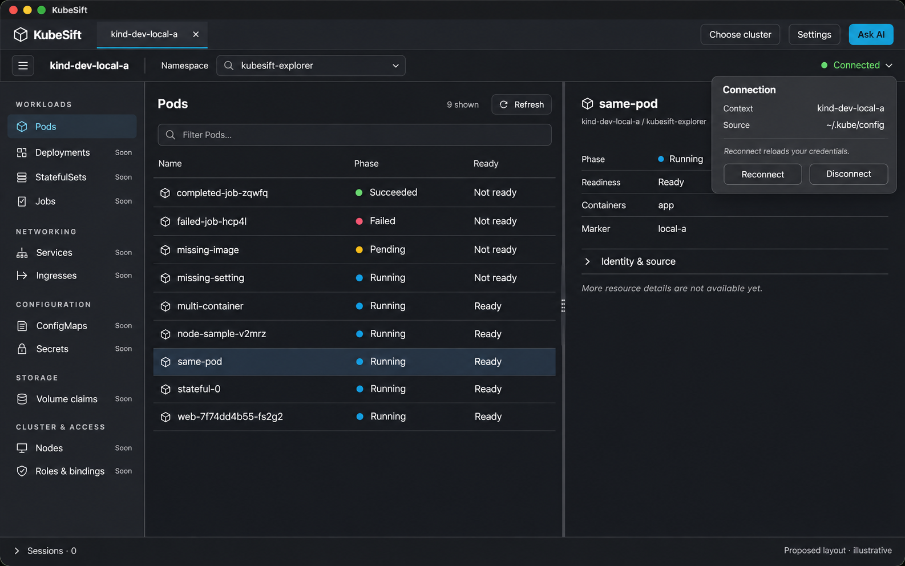

# KubeSift

A Kubernetes desktop workspace for exploring clusters, operating workloads and investigating failures with AI-assisted explanations grounded in cluster evidence.

**Local-first · Multi-cluster · Go + React · Open source**

KubeSift brings resource state, events, logs and configuration into one workspace, so understanding a failing Pod does not require switching between several tools. Inspired by the workflows of Lens and K9s, it combines a visual explorer with keyboard-driven interactions and a contextual AI assistant.

> KubeSift is under active development. The capabilities below describe the intended product experience, not a guarantee that every feature is available in the current build.

## One workspace for your clusters

- **Explore:** browse workloads, networking, storage, configuration and custom resources; inspect status, YAML, events and container logs together.
- **Work across clusters:** use independent cluster tabs with visible context and namespace identity. Assign your own environment labels and keep each tab’s navigation separate.
- **Operate:** edit YAML, restart and scale workloads, delete resources, inspect rollouts and roll back supported workloads. Review disruptive actions against an explicit target.
- **Keep sessions together:** access Pod terminals, follow logs and manage port forwards from a persistent Sessions dock.
- **Administer:** manage Helm releases, inspect available CPU/memory metrics and perform node maintenance. Dedicated OpenShift workflows cover Projects, Routes, Builds and Operators.
- **Investigate with AI:** open a right-side assistant from any page, collect relevant evidence and inspect the sources behind a diagnosis. Configure a default AI provider with per-cluster overrides.

Light and dark themes share the same workspace layout, with the system appearance as the default. The interface is designed for both laptop screens and external monitors.

### Design reference



*Design reference, not a screenshot of the current application.* See the [light-theme reference and workspace mockups](docs/ux/mocks/index.html).

## Connect using your existing tools

KubeSift is designed to reuse local kubeconfig files and their authentication flows, including OpenShift `oc login`, AWS CLI/SSO for EKS and Azure CLI credentials for AKS. Credential helpers require review before execution; remembered trust can be revoked and executable configuration changes require another review.

Kubernetes RBAC remains authoritative. Every operation belongs to an explicit cluster and resource target, so switching tabs cannot silently redirect an action.

KubeSift does not install agents, monitoring stacks or other infrastructure for its own functionality. Metrics come from services already available in the cluster. User-initiated Helm chart and Operator installations are separate, explicit operations with permission checks and confirmations.

## AI with visible evidence

The intended AI experience explains likely causes using resource status, events, configuration, relevant logs and available metrics. Findings should distinguish observations from hypotheses and link back to timestamped evidence.

Provider configuration uses your own API access, with a default profile and cluster-specific overrides. Data-sharing controls and payload inspection make model requests visible; credentials and Secret values are excluded from AI context. Redaction cannot guarantee detection of every sensitive value, so sharing remains an explicit product concern.

See the [security model](docs/security/security-model.html) for credential handling, operation safeguards and AI data boundaries.

## Develop locally

The desktop application uses **Wails and Go**, with **React and TypeScript** for the frontend and **client-go** for Kubernetes access. Native packaging is currently exercised on macOS.

Before building, install Go, Node.js/npm, the Wails CLI and the macOS build tools described in the [toolchain reference](docs/engineering/toolchain.html). Use the repository’s pinned dependencies rather than substituting arbitrary versions. Python 3 is also required by the repository checks and source-description tooling.

From the repository root:

```sh
npm ci
wails3 task build
```

To package and open the local macOS application:

```sh
wails3 task package
open bin/kubesift.app
```

For the development workflow:

```sh
wails3 task dev
```

Build tasks generate desktop bindings and bundle frontend assets. Local packages are ad-hoc signed; these commands do not publish a release.

### Checks and cluster testing

Run the standard repository checks with:

```sh
scripts/check.sh
```

Cluster integration checks use explicit local fixtures and are separate from the standard checks. Read the [local development guide](docs/engineering/local-development.html) before creating fixtures or running mutations; it defines shared cluster ownership, approved contexts and cleanup boundaries. Docker, kind and kubectl are needed for the local Kubernetes workflows.

## Repository layout

```text
cmd/kubesift/   Desktop entry point
internal/      Go services and desktop integration
frontend/      React interface and desktop bindings
build/         Native build and packaging configuration
scripts/       Development and verification tools
tests/         Test fixtures and integration support
docs/          Product, architecture, UX and engineering documentation
```

Domain services stay independent of the desktop bridge. Project-owned source files include plain-English descriptions of their purpose, consumers and important behavior; the [engineering playbook](docs/engineering/engineering.html) defines the conventions.

## Documentation and contributing

Start with the [documentation index](docs/index.html) for the product and engineering references. Most reader-facing documents are HTML; open them locally in a browser after cloning the repository.

- [Product requirements](docs/product/requirements.html) and [capability inventory](docs/product/feature-matrix.html)
- [Architecture](docs/architecture/overview.html) and [design decisions](docs/architecture/decisions.html)
- [Workspace interactions](docs/ux/workflows.html)
- [Engineering practices](docs/engineering/engineering.html) and [Git workflow](docs/engineering/gitworkflow.md)

For contributions, keep changes focused, follow the documented service boundaries and include meaningful verification appropriate to the change. Use synthetic fixtures for tests and preserve existing local cluster resources. Agent-assisted contributions should also follow [AGENTS.md](AGENTS.md).

## License

KubeSift is licensed under [Apache License 2.0](LICENSE). See [NOTICE](NOTICE) for project notices.
